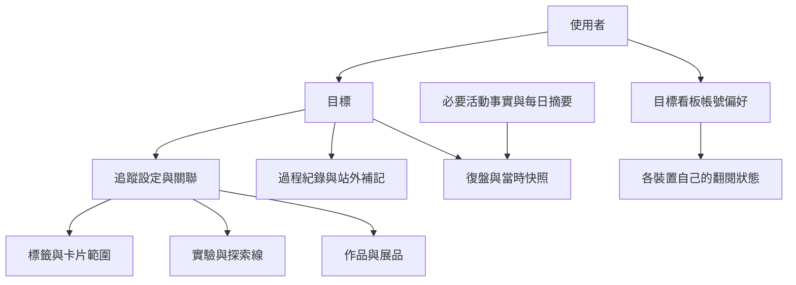

# Echo Gallery｜目標追蹤、週期復盤與目標看板需求說明

> 版本：v0.5
> 整理日期：2026-10-31
> 更新日期：2026-11-01
> 狀態：需求基線；批次 A 程式已實作，本機改表與人工驗收待完成，B／C 尚未實作
> 範圍：整合本次對話的需求、設計、評估、修正與尚待決策事項
> 本文件不是程式、API、資料庫或 Git 寫入授權；資料表名稱與技術拆分仍須經實作規劃確認。

## 1. 文件用途與決策標記

本文件承接「以期間目標串聯資訊關注、探索實踐與成果，再透過復盤調整方向」的構想，將討論整理成可審閱及後續拆分實作的需求基線。

本文件採以下標記，避免將 AI 提案當成使用者已逐項核准的規格：

| 標記 | 意義 |
| --- | --- |
| 已確認方向 | 使用者明確提出或確認，或依本次確認規則採用的方向 |
| 設計基線 | AI 已提出且使用者未要求修改的方案，依使用者指示默認採用；不因缺少逐項回覆而重新列為待確認 |
| 待決 | 討論尚未給出具體方案或仍有未選定的互斥選項；不包含已默認採用的建議 |
| 被取代 | 曾討論過，但已被後續方向取代，不能混入目前設計 |
| 現況 | 由目前程式、型別與相關文件查核的能力，不代表新需求已完成 |

需求採用規則：對話中 AI 已提出的設計方案與建議，若使用者沒有特別要求修改，則默認採用；有後續修正時，以最新方案為準。跨裝置「同步目標與篩選偏好、各裝置各自翻閱」亦已獲使用者明確確認。此規則確立功能設計，不等於授權立即修改產品程式或執行資料庫、Git 操作。

已完成現況盤點與產品評估；後續不需無理由重做全站調查。需要實作時，只針對本文件涉及的行為、資料及最新差異補查。

畫面盤點以現有 Vue 模板、元件與互動程式為依據，尚未完成本需求的瀏覽器操作驗收。資料結構依 JPA 映射與服務邏輯判讀，未連線查核實際本機或正式資料庫 schema。

### 1.1 內容索引

- 第 2～4 節：需求來源、產品定位與最新決策摘要。
- 第 5～9 節：物件職責、目標建立、狀態、追蹤及指標。
- 第 10～13 節：活動保存、快照、內容清理與卡片內容更新時間。
- 第 14～18 節：總覽、目標管理、全站標示、目標看板與跨裝置行為。
- 第 19～21 節：復盤、策略調整、結束與遊戲化表現。
- 第 22～25 節：資料架構、效能、權限與既有 UI 重用。
- 第 26～29 節：完整情境、驗收、待決事項及被取代方案。
- 第 30～31 節：實作規劃銜接與參考依據。

## 2. 需求來源與希望解決的問題

### 2.1 使用者原始構想

1. 使用者能選定時間區間與目標，在總覽固定看見。
2. 透過相關標籤與卡片，觀察近期關注的資訊是否與目標有關。
3. 透過實驗場、探索線及紀錄，觀察近期探索與實踐。
4. 透過作品與展品，觀察正在形成及已完成的成果。
5. 定期復盤、自我量化評分，判斷投入是否有幫助。
6. 目標可新增、修改、暫停、完成、結束及刪除。
7. 未順利推進時，引導使用者從資訊、方法、實際經歷及結果重新評估。
8. 同時支持「完成原定目標」與「透過探索辨認真正想追求的方向」。

使用者引用夢想相簿、夢想存錢筒、成功日記及養鵝作為體驗意象。本產品的量化材料是內容與活動證據；目前不將紀錄數換算為實際投入時數或人生評分。

### 2.2 希望改善的使用體驗

- 不必跨多個畫面自行拼湊「最近的收藏、探索與成果是否支持同一方向」。
- 長期學習、創作與探索尚未完成時，也能看見有意義的中途累積。
- 復盤後能決定繼續、換方法、縮小範圍、轉向、暫停或結束。
- 相關材料能被主動取用，不必等待一般今日回流剛好選中。
- 保留原有統計與追蹤，不把減壓誤解為移除所有數字。
- 單次閱讀、觀察或發現可以成立，不要求每次使用都產出作品、發表或入藏。

## 3. 產品定位與邊界

### 3.1 核心定義

目標層是一個跨越既有功能的觀測與決策脈絡：

```text
設定期間與期待
  → 選擇是否追蹤站內內容
  → 繼續收藏、探索、製作或在站外投入
  → 回看期間證據
  → 評估有效性與方向認同
  → 決定下一階段安排
```

目標同時容納兩種結果，分別呈現：

| 結果 | 提問 |
| --- | --- |
| 達成情況 | 原本希望發生什麼？實際完成到哪裡？ |
| 探索收穫 | 得到什麼理解？改變什麼判斷？出現什麼新方向？ |

未達原期待可以同時有收穫；轉向也不自動等於成功。系統保留原期待、實際結果及使用者判斷。

### 3.2 不強迫的事項

- 不必建立目標才能使用原有功能。
- 不必讓所有收藏與探索都有目標歸屬。
- 不必追蹤所有面向。
- 不必有作品或展品才能復盤、完成或結束目標。
- 不以數量直接判斷努力、理解品質或目標完成百分比。
- 不以長時間使用、每日打卡或連續登入作為目前成功標準。
- 不自動將卡片、探索、作品、展品串成每人都必須完成的漏斗。

### 3.3 原有功能的保留

原有摘要、統計、操作、快捷入口、分頁與響應式設計應持續保留。新增目標能力以局部組合與接續為主，不藉此重做全站。

先前總覽調整已將實驗放在作品前方，並隱藏空作品與空館藏區塊；本需求不回退該改動。Demo 內容與示範流程不納入此次產品設計調整，但未來若 Demo 帳號可使用目標，仍須處理資料清理生命週期。

## 4. 最新決策摘要

| 編號 | 項目 | 最新方向 | 標記 |
| --- | --- | --- | --- |
| D01 | 完成與探索 | 兩者共存，結果與收穫分開呈現 | 已確認方向 |
| D02 | 目標是否必用 | 可選用，原功能可獨立存在 | 設計基線 |
| D03 | 探索問題欄位 | 目標不再設「想釐清什麼」獨立欄位，具體問題交給實驗場 | 設計基線 |
| D04 | 追蹤來源 | 選既有標籤、實驗／探索線、作品與展品，不建立同名副本 | 已確認方向 |
| D05 | 追蹤彈性 | 站內來源與指標均可選；未啟用不顯示空區或新增催促 | 已確認方向 |
| D06 | 資料層次 | 現況、必要歷史紀錄／摘要、復盤快照各有職責 | 設計基線 |
| D07 | 卡片文字修改 | 新增最後內容修改時間，歷史以每日摘要為建議，不逐次永久統計零碎儲存 | 最新設計基線 |
| D08 | 關聯標示 | 全站一致的目標圖示＋數量，使用可區分的識別色 | 已確認方向 |
| D09 | 目標看板 | 獨立主導覽入口，名稱為「目標看板」 | 最新設計基線 |
| D10 | 看板內容 | 不要求到回流日，每批五張，可換批；同輪優先不重複為配套建議 | 使用者提出方向＋設計基線 |
| D11 | 排程效果 | 看板展示、閱讀、換批不推進今日回流排程或一般更新時間 | 最新設計基線 |
| D12 | 選目標 | 預設所有進行中目標；自選允許其他狀態 | 最新設計基線 |
| D13 | 跨裝置 | 同步目標選擇與篩選偏好，各裝置各自翻閱 | 已確認方向 |
| D14 | 閱讀輪次 | 不要求手機、電腦接續同一批，不新增永久閱讀輪次作為本版前提 | 已確認方向 |
| D15 | 全部卡片 | 目標看板獨立後，不再增加「目標回流」檢視 | 依 D09 調整 |

使用者曾指定的「更新／目標回流／熱門／隨機起點／已封存／稍後再看」順序，屬獨立看板方案前的決策。依最新方向移出目標入口後，其餘維持「更新／熱門／隨機起點／已封存／稍後再看」。

## 5. 物件職責與關聯

| 物件 | 責任 | 與目標的關係 |
| --- | --- | --- |
| 目標 | 這段時間想往哪裡前進、希望發生什麼改變 | 提供期間、期待與觀測背景 |
| 卡片 | 保存、回流及取用內容 | 由標籤或明確補入形成材料範圍 |
| 實驗 | 問題、目的、試法、發現與理解 | 目標可引用，不重複填寫探索問題 |
| 探索線 | 實驗內具體方向的材料、行動、發現與成果整理 | 可只追蹤指定線，不必整個實驗 |
| 作品 | 持續製作一件可辨識的內容或外部成果 | 提供目前狀態與部分期間變化 |
| 展品 | 已完成成果、試煉與持續價值 | 提供成果經歷與價值延續 |
| 復盤 | 對照期待、證據、自評與決策 | 保留當時理解，不代替原內容管理 |

同一內容可支持多個目標，不能只在原資料列加一個唯一的 `goal_id`。目前作品的主要實驗與探索線關聯是不同關係；不應只由主要實驗推算全部目標脈絡。

作品完成、發表、入藏維持獨立，不將同一作品及其展品相加為兩份獨立創作。

## 6. 目標建立與編輯

### 6.1 建議欄位

| 欄位 | 規則 | 範例 |
| --- | --- | --- |
| 名稱 | 必填 | 完成第一份短篇初稿 |
| 開始／結束日期 | 必填，UI 包含起訖當日 | 11/01～11/30 |
| 期望結果／希望發生的改變 | 選填，可後補 | 有一份可完整閱讀的初稿 |
| 為什麼想做 | 選填 | 想將長期構想實際寫出來 |
| 圖片 | 選填，沿用圖片網址與預覽 | 代表期待的圖片 |
| 復盤頻率 | 建議預設 7 天，可選 14／30 天與自訂天數 | 每 7 天 |
| 是否啟用定期提醒 | 建議可關閉，避免目標等同強制週期作業 | 開啟 |
| 固定於總覽 | 可設定與調整順序 | 開啟 |
| 站內追蹤 | 選填，詳見第 8 節 | 卡片＋指定探索線 |

「想釐清什麼」不再是目標的另一份問題欄位。若期待是探索方向，可在期望結果寫「經歷幾次實際創作後，決定是否持續」，具體寫作問題仍在實驗場。

### 6.2 建立流程

1. 填名稱與期間。
2. 選填期望、動機、圖片與復盤設定。
3. 選擇是否設定站內追蹤，也可稍後處理。
4. 保存後顯示名稱、期間及狀態，提供查看目標與管理追蹤入口。

成功提示不得連續要求建立實驗、作品或展品。未設定追蹤可以正常使用補記、自評與復盤。

### 6.3 編輯與重要變更

- 錯字、圖片等一般編輯，不必新增一份完整統計快照。
- 期間、期望結果、方向或追蹤範圍改變，保存生效時間、前後差異及理由。
- 改動不無聲覆蓋舊復盤當時的期待與設定。
- 變更理由的必填條件與「一般文字修正／實質改變」的判定，列為待決。
- 顯示目前設定，另有目標演變入口可讀重要調整。

## 7. 狀態與期間

| 狀態 | 意義 | 建議行為 |
| --- | --- | --- |
| 未開始 | 已安排，尚未正式投入 | 可設定來源與預先閱讀，不催復盤 |
| 進行中 | 正在追求 | 參與預設目標範圍與提醒 |
| 暫停 | 暫時停止主動追求 | 停止一般提醒，保留原內容 |
| 已完成 | 使用者確認原期待達成 | 保存期間回顧 |
| 已結束 | 部分達成、轉向或不再追求 | 保存結果、收穫及結束原因 |

- 封存為獨立的顯示管理設定，不等於完成或刪除。
- 未來開始日期預設未開始；到日轉進行中，依默認採用的方案處理。
- 提前開始須明確確認開始時間。
- 到期不自動失敗、完成或結束，顯示「期間已到，待回顧」。
- 暫停不自動延長期限；恢復可選擇調整日期。
- 已完成、已結束及暫停不因日期跨越自行回到進行中。
- 重新追求可重新開啟或建立後續目標，舊回顧保留。
- 刪除目標只刪其專屬資料及關聯，不刪原卡片、實驗、作品與展品。

目標暫停與卡片暫停回流是不同狀態。是否納入目標看板，由第 17 節選擇規則決定；是否計入目標正式期間的活動，需另外定義，不能從看板可讀直接推斷。

## 8. 追蹤來源與既有資料

### 8.1 選擇既有對象

| 來源 | 設定方式 | 邊界 |
| --- | --- | --- |
| 卡片 | 選既有標籤，任一／全部符合 | 使用 ID，不複製標籤或卡片 |
| 實驗 | 選整個實驗 | 清楚標示包含範圍 |
| 探索線 | 選指定探索線 | 不假設同實驗其他線都相關 |
| 作品 | 搜尋並直接選取 | 不限於單一主要實驗 |
| 展品 | 搜尋並直接選取 | 試煉與收益可作候選指標 |
| 個別證據 | 手動補入／排除 | 與自動規則的來源可區分 |

例：原本已有「寫作」「人物塑造」標籤、兩條探索線與「短篇 A」，建立目標時直接選用，不要求重新建立。

標籤改名仍依 ID 維持關聯；刪除後標示設定失效，同名新標籤不自動接回。

### 8.2 完整設定流程

1. 啟用需要的來源。
2. 搜尋、選取既有對象。
3. 預覽符合內容與數量，並說明納入原因。
4. 可移除選項或排除例外。
5. 確認保存後生效；取消保留原設定。

來源採聯集並按對象去重。直接選取、標籤符合及來自關聯範圍可以同時作為納入原因，但不重複計數。個別排除優先於自動匹配，具體可排除的層級須在技術規格確認。

### 8.3 既有資源與期間活動分開

例：建立目標時已有 20 張相關卡片、2 條探索線、1 件作品。

- 它們立即可作目前資源，不因加入目標就變成本期新增。
- 本期新增卡片依建立時間與統計口徑計算。
- 既有作品目前初版完成，不等於本期才初版完成。
- 之後的內容加工、發現、階段變化可形成期間資料。
- 若目標期間在追蹤啟用之前，明示哪些依目前保留資料回算、哪些無法得知。

現在符合標籤的內容集合，與當時被納入的活動證據，可能不同。畫面分別命名為「相關內容」與「期間證據」，不要共用一個看似相同的數字。

### 8.4 選填與零值

| 情境 | 呈現 |
| --- | --- |
| 完全不追蹤站內內容 | 目標、補記、自評、復盤及決策仍可使用 |
| 只追蹤卡片 | 只顯示卡片相關內容與指標 |
| 沒選作品／展品 | 不顯示空區，不顯示建立／入藏催促 |
| 已啟用指標且為零 | 顯示 0，語氣中性 |
| 未啟用指標 | 不顯示 |
| 未開始／資料未涵蓋 | 顯示相應說明，不當成 0 |
| 查詢失敗 | 錯誤與重試，不當成空集合 |

指標顯示與追蹤範圍是兩個設定。選一條探索線，不代表必須開啟其中所有數量。關閉顯示是否同時停止後續資料收集，屬待決，不能以隱藏畫面自動推定刪除資料。

## 9. 指標字典

### 9.1 分類

| 分類 | 提問 | 不代表 |
| --- | --- | --- |
| 關注 | 保存、重讀或加工了哪些相關資訊？ | 實際投入時數、閱讀深度 |
| 探索與實踐 | 留下哪些方法、觀察與現實經驗？ | 紀錄數直接等於執行次數 |
| 成果 | 哪些成果正在形成、完成或產生價值？ | 每個目標都必須做作品 |
| 主觀判斷 | 這些投入有效嗎？是否仍認同方向？ | 跨人可比較的成長總分 |

### 9.2 候選指標與保存粒度

下表是可選指標，不代表預設全部顯示。啟用範圍、顯示順序及首頁摘要數量仍需審閱。

| ID | 指標 | 資料來源／粒度 | 解讀與限制 |
| --- | --- | --- | --- |
| M01 | 目前相關卡片數 | 現況查詢、卡片去重 | 現在可用的相關材料 |
| M02 | 本期新增相關卡片數 | 建立事實、卡片去重 | 新保存，不因新關聯目標而冒充新卡片 |
| M03 | 本期修改過內容的卡片數 | 每日內容修改摘要、區間內卡片去重 | 新版採每日摘要，不保存每次零碎儲存計數 |
| M04 | 有內容修改的日期 | 每日摘要、日期去重 | 加工發生在哪些天，不等於有效工時 |
| M05 | 本期完成今日回顧的卡片數 | 真正回顧事實、卡片去重 | 目標看板單純閱讀不算今日回顧 |
| M06 | 本期再次運用的既有卡片 | 加入相關材料的事實、卡片去重 | 原內容再次派上用場，不等於新收藏 |
| M07 | 目前相關實驗／探索線 | 現況查詢 | 目前採用哪些探索脈絡 |
| M08 | 目前行動備選數 | 現有方法資料 | 方法數，不是執行次數 |
| M09 | 目前保留發現數 | 尚未刪除的活動發現 | 清理後可減少 |
| M10 | 本期新增發現數 | 新增發現事實 | 原活動清理後仍可保留曾新增的數量 |
| M11 | 本期新增行動備選數 | 方法建立事實、選配 | 規劃證據，不宣稱實際做過 |
| M12 | 本期整理次數 | 成功提交的整理事實 | 預覽、取消、同請求重試不計 |
| M13 | 目前作品與階段 | 現況查詢 | 可回退／跳選，不由修改文字自動推定 |
| M14 | 本期標記初版完成的作品 | 完成事實及日期、作品去重 | 避免階段反覆切換重複算同一首次完成 |
| M15 | 目前關聯展品 | 現況查詢 | 可包含既有成果 |
| M16 | 本期入藏成果數 | 入藏事實、展品去重 | 入藏時間與作品實際完成日期不同 |
| M17 | 本期試煉嘗試／通過 | 既有逐次嘗試及條件快照 | 各自呈現，不只保留通過 |
| M18 | 本期價值產出 | 既有收益紀錄、實際發生日期 | 不限金錢，紀錄數與展品件數不同 |
| M19 | 自訂站外活動量 | 使用者主動登錄 | 單位與行為需由使用者定義 |
| M20 | 有效性、進展與方向認同 | 使用者復盤 | 分項保存，不合成總分 |

整理事實另應能保存「實際清除多少筆」與可用輸出去向，以支持本次討論中的「新增 5 筆、清除 8 筆、目前剩 7 筆」解釋。若畫面啟用「本期整理清除發現數」，應累計成功整理時實際清除的筆數；不由整理次數或目前餘量推估。不清理的輸出其清除數為 0；失敗、預覽、取消與同請求重試不重複計入。這是整理活動的明細／選配指標，不代表所有目標都要再顯示一個數字，也不等同所有刪除原因的完整稽核日誌。

### 9.3 共同口徑

- 存量、期間活動、已選範圍、輸入長度及主觀評分不可混稱。
- 同一內容符合多條規則，在同一目標的同一指標中只算一次。
- 同一內容可支持多個目標；跨目標合計須去重或標示為關聯筆數。
- 整理五筆發現成一張卡片，不等於六次發現；各指標不相加成總產量。
- 標籤符合卡片占新增收藏的比例，只能命名為收藏相關比例，不能稱為時間／注意力占比。
- 行動備選、發現、站外練習次數是不同單位。
- 不由兩次現況差值推算期間新增與清除量。
- 期間來源刪除、更正、補登的規則需明示，不能無聲改寫已保存復盤。
- 本次主要粒度以日期／完整觀測區間為方向，不承諾任意時分秒範圍的卡片修改歷史。
- 發生日期與登錄時間分開：試煉、收益與站外補記按實際發生日期歸期，另保留建立／登錄時間；一般站內活動按操作成功時間歸期。補登或更正日期不得無聲改寫已保存復盤，須依修訂規則處理。

## 10. 現況與歷史保存方式

### 10.1 三種職責並用

| 資料 | 保存內容 | 回答 |
| --- | --- | --- |
| 現況 | 原內容與目前狀態 | 現在有什麼？ |
| 必要活動事實／每日摘要 | 已定義活動的時間、對象與必要數量 | 這段期間發生什麼？ |
| 復盤快照 | 當時設定、數字、證據參考、自評與決策 | 當時如何理解？ |

例如 11/1 有 10 筆發現，11/3 新增 5 筆，11/5 清除 8 筆，11/7 剩 7 筆。現況只得知 7；兩次快照只得知 10 與 7；要知道中間新增 5、清除 8，需在發生時保存必要事實。

### 10.2 保存粒度依產品問題決定

- 試煉、收益：每筆是有內容與日期的經歷，沿用逐筆紀錄。
- 發現新增、整理提交：若啟用相應歷史指標，保存必要事實。
- 卡片零碎文字保存：每日摘要，詳見第 13 節。
- 看板展示、上一批、下一批：本版作為裝置閱讀狀態，不要求永久曝光日誌。
- 不保存每次按鍵、滑鼠或捲動。
- 活動事實不等於全文版本庫，不預設複製每份原文。
- 所有事實在操作成功後才成立；失敗回滾與同請求重試不得重複計數。

同一份站內事實可支持多個目標，但不因被兩個目標引用就建立兩次活動。卡片建立、今日回顧、發現新增、整理、作品階段變更、入藏等，依已啟用指標及資料涵蓋政策保存必要資訊；試煉與收益優先使用既有逐筆紀錄。卡片文字修改則按每日摘要保存，不能把前一版的逐次修改事件建議重新當成通則。

### 10.3 歷史能力邊界

現有卡片最後時間與作品最後狀態不足以還原完整過去。追蹤啟用前：

- 可用建立日期、仍存在的逐筆紀錄等回算部分資料。
- 不可拿 `updatedAt` 假裝內容修改時間。
- 不可從歷次整理長文解析成可靠的逐筆活動量。
- 不可由目前作品階段倒推出所有過去階段。
- 必須標示資料涵蓋起點與回算口徑。

目標何時建立、目標期間何時開始、追蹤規則何時生效，是不同時間。具體的舊資料回補與中途納入規則列為實作前必決事項。

## 11. 復盤快照與原內容連結

快照保存「當時看見什麼、怎麼判斷」，不等於只留數字，也不等於永久保存所有原文。

| 部分 | 保存例子 |
| --- | --- |
| 當時設定 | 名稱、期間、期望、追蹤範圍及指標定義版本 |
| 當時結果 | 指標值、單位、統計截止時間、資料涵蓋說明 |
| 證據參考 | 使用者選定的來源識別與必要辨識資訊 |
| 使用者判斷 | 分項自評、觀察、收穫、決策 |

範例：11/14 快照顯示「短篇 A：製作中」，之後作品可分享，舊快照仍顯示當時製作中，另提供「查看目前作品」。

- 原內容仍存在：保留連結，清楚說讀取目前版本。
- 原內容已修改：不把現在的內容當成當時全文。
- 原內容已刪除：入口不可用，使用者自己寫的復盤保留。
- 原文副本與摘要的刪除、保留政策須明確，不能以快照名義無聲永久保存已刪除全文。
- 保存後更正復盤需有修訂資訊；不自動依現在資料重算舊數字。
- 快照與活動日誌不可互相替代：快照補不回提交前已清除的活動。

## 12. 探索清理與歷史刪除

### 12.1 現有生命週期

現有探索上方與探索線共用活動資料；整理可清除逐筆發現，並將確認文字追加至歷次整理。歷次整理可編輯或清空，不保證還原原始逐筆證據。

目前整理成卡片且不清理時，也不能一律假設另外保存了一份相同歷史文字；需依實際輸出模式判斷目的地。

### 12.2 追蹤呈現

| 狀況 | 顯示方式 |
| --- | --- |
| 原發現仍在 | 查看原發現 |
| 曾整理且目的內容可用 | 曾整理，可查看現有整理內容 |
| 目的內容已修改，無法定位原段落 | 說明現有內容可能不同 |
| 原發現與整理內容都不可用 | 內容已不可用，沒有假查看按鈕 |
| 整理成卡片且卡片仍在 | 查看成果卡片 |
| 成果卡片也刪除 | 顯示來源不可用 |

「已整理」只代表操作曾發生，不代表原文永久完整保存。目前每方法一個歷史長文，無法保證精確定位每次輸出段落；若需要可靠逐輪去向，需另外設計整理批次／來源關係，列為待決擴充。

### 12.3 指標與清理的關係

- 目前保留發現數：隨清理下降。
- 本期曾新增發現數：若已捕捉新增事實，可保留歷史數量。
- 清除發現通常不刪行動備選，兩種數量不能一起扣。
- 不解析歷史長文來補足已刪除筆數。
- 不在每次刪除、輸出、整理時連續詢問是否更新各個目標。
- 需要更正統計時，在目標／證據中提供明確更正，不改寫原物件實際筆數。

## 13. 卡片內容更新時間與每日摘要

### 13.1 新增欄位的職責

建議 `cards` 新增選填 `content_updated_at`，對應 `contentUpdatedAt`。

只在卡片筆記 `cardNote` 或內文 `content` 的最終保存值實際改變時更新。標題、標籤、網址、圖片、星標、回顧、排程、封存及待整理狀態不觸發此欄位。

- 同次保存改兩個文字欄位，只更新一次時間。
- 清空文字也算實際變更；保存相同內容不算。
- 一般卡片編輯與探索整理追加正文都須涵蓋。
- 由後端交易成功時處理，不依前端宣稱有改字。
- 建議新建先為 `null`，建立時間由 `createdAt` 表達。
- 舊資料先保留 `null`，畫面說「尚無內容修改時間紀錄」，不說從未修改。
- 不把既有正文 `contentVersion` 當成歷史修改次數；該欄位仍負責並行保護。

### 13.2 最新的保存粒度

不預設永久保存每次零碎儲存，也不顯示十次儲存等於十次進展。若要追蹤歷史，以「某張卡片於某日有內容修改」的每日摘要支持日期區間統計。

| 情境 | 最後修改時間 | 當日摘要 | 本期修改卡片數 |
| --- | --- | --- | --- |
| A 同一天改 10 次 | 最後一次成功修改 | A 當天一份摘要 | 1 張 |
| A 隔天再修改 | 更新成隔天時間 | 多一個日期摘要 | 仍 1 張 |
| 同日修改 A、B | 各自最後時間 | 各一份摘要 | 2 張 |
| 重送相同成功請求 | 不產生新的實際變更 | 不重複增加 | 不增加 |

按整個區間去重，不能將每日卡片數相加當作整週不同卡片數。每日摘要不提供任意時分秒範圍的精確修改歷史，也不保存每次正文版本。

有修改的日期按日期去重：同一天改 A 十次，為 1 張卡片、1 個修改日；隔天又改 A，整期仍為 1 張卡片、2 個修改日。若其中一次帶來重要突破，可在復盤主動選為重要進展並留下解讀，例如「終於整理出人物衝突的核心」，不由儲存次數替使用者判定其意義。

摘要的唯一鍵、目標歸屬保存方式、同日標籤／追蹤規則改變如何處理，須在資料模型階段定案。

## 14. 總覽目標區

### 14.1 呈現內容

新增可收合的固定目標區，提供排序與查看全部。原實驗、作品、展品、提醒及統計持續保留。

單筆展開示意，數字均為情境範例：

```text
完成第一份短篇初稿                         進行中
11/01～11/30

本期新增相關卡片 8 張
本期新增發現 5 筆
目前作品 1 件：製作中

上次決定：先完成角色做出選擇的場景
下次復盤：11/22

［開啟目標看板］［接續探索／作品］［復盤］
```

- 只顯示該目標啟用的指標，不要求固定三欄都存在。
- 數字能查看對應內容或證據。
- 時間經過不是完成百分比。
- 可設定接續對象，未設定時不必留空白操作列。
- 沒有目標的使用者仍可直接使用原總覽。
- 多目標預覽與收合方式需在畫面設計驗證，不擅自改原實驗摘要密度。

### 14.2 舊 MVP 的統計回饋

保留原有存量、活動、歷程與字元數。目標新增的是共同脈絡，不取代各頁原有追蹤。

整合時須確認數字同步、預覽與總數區分、載入／錯誤不偽裝成零。目標功能不順帶修改原有回流與成果語意。

## 15. 目標列表與詳情

### 15.1 管理入口

建議主導覽設「目標看板」，看板頁首提供「管理目標」進入列表；總覽亦可進入。是否另設獨立管理選單列為待決，不預設新增兩個相近主入口。

### 15.2 目標列表

- 建立、搜尋、依狀態／封存篩選。
- 顯示目前結果總數，區分符合篩選與全部數量。
- 摘要包含名稱、期間、狀態、最近決策與選定指標。
- 可固定／取消固定、調整總覽順序、編輯、暫停／恢復。
- 不把無作品或無展品當成資料缺漏。

### 15.3 目標詳情

| 區塊 | 內容 |
| --- | --- |
| 目前期待 | 名稱、期間、期望、動機、圖片 |
| 期間觀測 | 已啟用指標與少量內容預覽 |
| 當前安排 | 最近決策、接續對象、下次復盤 |
| 證據 | 原因、日期、來源與可用性 |
| 復盤歷程 | 各次區間、觀察、自評與決策 |
| 目標演變 | 期待、期限及追蹤範圍的重要變更 |

### 15.4 證據清單

每筆顯示來源、摘要、時間、納入原因、目前狀態與可用操作；完整原文按需閱讀，列表不傳全部全文。

區分「排除這次證據」與「此內容不再自動納入」；確切支援層級列待決。任何排除不無聲改寫已保存復盤。

## 16. 全站目標識別 UI

### 16.1 統一圖示與顏色

採旗幟 `Flag` 圖示＋數字，例如 `⚑ 2`；實際使用既有圖示套件，不使用文字旗幟字元作正式圖示。

- 原有實驗場使用 `Aim`，目標採另一圖形便於辨認。
- 建議柔和紫色作目標業務識別，提供明暗主題 token。
- 尺寸、圓角、數字排版參照 `RecordCount`，不將所有既有藍色統計改色。
- 圖示與數量為一個完整的可點擊單位。
- 主要操作、成功／警告／錯誤色維持現有語意。
- 圖形、數字與可存取名稱共同識別，不只依賴顏色。

### 16.2 位置與互動

| 對象 | 放置建議 | 展開內容 |
| --- | --- | --- |
| 卡片 | 現有資訊／操作區 | 相關目標及符合原因 |
| 標籤 | 卡片數附近，但圖形與數量可區分 | 使用此標籤的目標 |
| 實驗／探索線 | 標頭或狀態附近 | 整體或部分範圍的關聯 |
| 作品／展品 | 原有摘要資訊區 | 直接或間接關聯的目標 |

- 零關聯不顯示；載入中／錯誤不顯示假零。
- 點擊／鍵盤開啟名稱清單；手機不依賴 hover。
- 可存取名稱如「查看 2 個相關目標」。
- 列表不鋪開所有目標名稱，也不反覆寫「相關目標」長標籤。
- 暫停等狀態在展開清單中辨認。
- 預設徽章計入未封存的相關目標，展開清單顯示各自狀態；與看板預設只選進行中目標的規則分開。
- 不新增 `isTrackedByGoal` 布林欄位作來源真相；由實際多目標關聯批次查得。
- 存在於某個實驗不代表整個實驗全部被追蹤，標示須說明部分探索線。

## 17. 獨立目標看板

### 17.1 定位與入口

主導覽新增「目標看板」。其目的為持續翻閱相關材料，不要求到回流日、不改今日排程，名稱不再使用「目標回流」。

頁面建議包含：

```text
目標看板                                   ［管理目標］
目標範圍：所有進行中目標／自行選擇
篩選：包含暫停回流；不包含封存
相關卡片：38 張

本批五張卡片

［上一批］［下一批］［重新洗牌］
```

### 17.2 目標選單

| 模式 | 行為 |
| --- | --- |
| 所有進行中目標 | 預設動態範圍，新啟動自動納入；暫停、完成或結束自動退出 |
| 自行選擇 | 多選既有目標，明確選過的目標不因暫停就悄悄退出 |

- 選擇器支援搜尋與狀態篩選，預設先列進行中。
- 可切換至未開始、暫停、已完成、已結束或全部未封存，主動重訪材料。
- 顯示且可選的目標，應確實參與此次材料範圍，不列出卻暗中忽略。
- 已封存目標是否另提供進階篩選為待決。
- 自選目標後來暫停，仍可閱讀；它的追求狀態沒有被自動恢復。
- 沒有卡片來源的目標需明示，不代表所有卡片；不能以空條件退回全庫。
- 沒選任何目標顯示尚未選擇，不擅自替使用者選全部。
- 沒有進行中目標時，動態模式沒有候選；仍可切換自選其他狀態。

### 17.3 卡片來源與狀態

- 多目標卡片取聯集並去重。
- 尚未到回流日可出現。
- 已暫停回流建議預設可出現：暫停週期推送不等於不能主動閱讀。
- 已封存預設排除，提供包含設定。
- 只因閱讀，不恢復卡片回流或還原封存。
- 各種來源如何映射成卡片池須明確：標籤符合與探索線材料／成果是否都可用，列為必決設定。
- 材料池不足五張就顯示實際數量，不以重複卡片補滿。

### 17.4 分批體驗

- 預設每批五張，下一批取得另一組材料。
- 同輪優先不重複，不在每次按下一批時重新抽出相同內容。
- 上一批可回看，不把翻過當成讀懂。
- 多目標宜有輪替出現機會，避免大材料池目標完全淹沒小目標；具體抽選演算法仍待實作規劃。
- 同卡符合多目標仍只出現一次，可由目標徽章查看原因。
- 一輪結束明示目前範圍已展示完，可重新洗牌或調整目標。
- 若顯示翻閱數，使用「本輪已展示」，不宣稱完成閱讀。
- 不以本輪展示數作目標完成率。
- 新內容及範圍改變如何進入當輪，需訂定刷新規則，不承諾凍結全庫版本。

### 17.5 與今日回流的區分

| 行為 | 今日回流現況 | 目標看板設計 |
| --- | --- | --- |
| 候選 | 符合排程與批次規則 | 選定目標的材料，不限到期 |
| 開啟詳情 | 記為本輪回顧並推進排程 | 主動閱讀，不呼叫今日完成回顧操作 |
| 下一批 | 現有流程會處理原批未看卡片 | 只換顯示材料 |
| 離開／切換目標 | 沿現況 | 不改卡片日期、不增加稍後再看次數 |
| 同卡重複遇見 | 受今日排程控制 | 可主動再讀，與週期重逢是不同用途 |

目標看板看過後，今日回流仍可能出現同卡，屬設計上允許的重逢，不要求「看過就從今日消失」。

### 17.6 是否更新卡片

| 操作 | 更新目標偏好／裝置狀態 | 更新卡片本身 |
| --- | --- | --- |
| 選目標與篩選 | 保存帳號偏好 | 否 |
| 下一批／上一批／洗牌 | 裝置本地狀態 | 否 |
| 卡片出現、開啟閱讀 | 裝置閱讀狀態 | 不改回流欄位、一般更新時間與今日回顧統計 |
| 修改筆記／內文 | 無必然關係 | 是，沿用編輯規則 |
| 星標、週期、暫停、封存等明確操作 | 無必然關係 | 是，沿用原管理規則 |

目標看板自己的「下一批」不能借用今日「略過整批」的 API。卡片上的一般管理操作若仍提供「稍後再看」，必須清楚說明那會改卡片日期；按看板下一批絕不等同稍後再看。

單純目標閱讀不會使卡片浮到「全部卡片／更新」前方。實際編輯、星標等原有管理操作則依現況影響一般更新時間。

現況辨識：目前今日頁取當前批次及其排序，並非使用 `updatedAt` 作整頁最近更新排序；「全部卡片／更新」才依 `updatedAt` 排序。今日建立／換批會改部分卡片欄位，可能帶動其一般更新時間。

## 18. 跨裝置與裝置內閱讀狀態

### 18.1 已確認方式

跨裝置同步「想看什麼」，各裝置各自翻閱，不要求接續同一輪或同五張。

使用者已明確確認此簡化方案。本版不要求跨裝置接續同一批，不需為此再確認是否恢復伺服器閱讀輪次方案。

| 內容 | 保存位置／效果 |
| --- | --- |
| 動態全選／自選模式 | 帳號偏好，手機電腦一致 |
| 自選目標、篩選偏好 | 帳號偏好，跨裝置可取回 |
| 本輪順序、游標、上一批、目前五張 | 各裝置／瀏覽器工作階段 |
| 卡片內容與目標本身 | 原伺服器資料，各裝置讀取最新版 |

例：電腦選寫作與人物塑造，翻到第三批；手機進入仍使用兩個目標，但重新提供五張，不宣稱接續第三批。跨裝置可能重複遇見卡片，這是本版已接受的取捨。

### 18.2 不作為本版前提

- 不新增永久閱讀輪次表與輪次卡片表作為必要能力。
- 不要求跨裝置游標、批次版本或永久曝光紀錄。
- 不要求保存「已完成第幾批」或閱讀完成率。
- 同瀏覽器刷新是否接續、偏好何時保存及多裝置同時改偏好的衝突策略，列待決。
- 若後續確有找回另一裝置同五張的需求，再另案設計精確接續。

先前建議第一版支援「同瀏覽器重新整理後接續」，未被後續簡化提案取消，依默認採用規則保留；可用瀏覽器暫存做到，不要求跨裝置同步。暫存期限、刷新及失效處理仍待實作規劃，詳見 Q11。

現有隨機起點／游標可參考裝置內分批，但尚無目標來源條件與跨裝置偏好能力，不能宣稱可直接套用即完成。

## 19. 週期復盤與提醒

### 19.1 觸發與週期

設計基線：提醒可開關；預設每 7 天，可選 14／30 天或自訂。

- 第一次從目標開始時間起算；後續從上次復盤截止時間起算。
- 手動提前復盤後，以新的截止時間安排下一次。
- 逾期預設合併檢視上次截止至本次，不製造連續欠交表單。
- 保存精確區間與區間長度，不直接拿不同長度的總量比較優劣。
- 到期改提示期間回顧，不自動失敗。
- 多目標到期整合提示，不連續搶焦點。
- 正在編輯、提交或處理衝突時延後提示。
- 提供開始、稍後提醒；稍後與完成狀態由伺服器管理。
- 暫停停止一般提醒，恢復後重算方式待定。
- 本版站內提醒為範圍，Email／關站後推播未定。

時區先沿用現有應用程式 `Asia/Taipei`，日期區間內部以排他上界表達。提醒時間點、天數上限及漏期合併演算法須於技術規格確認。

### 19.2 復盤工作區

短提醒可用彈窗，完整證據核對與決策宜有專用工作區；手機不將長流程硬塞小彈窗。

| 步驟 | 內容 | 互動 |
| --- | --- | --- |
| 1 回看 | 區間、已啟用統計、重要內容、資料缺口 | 可閱讀來源、補記；不要求逐筆勾完 |
| 2 評估 | 資訊幫助、行動有效性、結果推進 | 可選 1～5、自述、無法判斷／不適用 |
| 3 看方向 | 是否仍認同、重要收穫、新問題 | 繼續認同／想調整／不確定／不再追求 |
| 4 做決定 | 繼續、換方法、調整、暫停、完成、結束、轉向 | 確認後保存，必要時銜接原功能 |

- 自評依目標啟用內容調整，沒有作品不必評作品。
- 不因沒有站內紀錄直接給零分。
- 分項分數不合成總分，也不將方向認同混成達成率。
- 1～5 的文字判準需與項目一起顯示；分數降低也可能是理解加深或評估標準改變。
- 至少確認本次決策；是否強制文字、哪些變更理由必填列待決。
- 可以維持原安排，不必每次產生新行動。
- 返回原步驟與閱讀來源時保留本次輸入，真正離開前保護未存內容。
- 跨裝置復盤草稿與自動保存尚未定案，不能套用作品已具備的正文復原能力作承諾。

## 20. 站外補記與策略銜接

### 20.1 站外補記

| 欄位 | 建議 |
| --- | --- |
| 名稱 | 必填，如「與朋友試談故事結局」 |
| 發生日期 | 必填，可補記過去 |
| 經過與觀察 | 選填 |
| 對目標的影響 | 選填 |
| 相關內容／佐證網址 | 選填，沿既有 URL 驗證 |

- 標示手動補記，與自動紀錄分開。
- 若同一件事已有站內資料，可引用，避免當成兩份獨立成果。
- 不憑文字相似自動合併。
- 手動計次須有明確名稱、單位、增減及更正紀錄，不直接改寫系統實際內容筆數。
- 不將補記自動換算工時。

### 20.2 決策與原功能

| 決策 | 保存 | 可接續 |
| --- | --- | --- |
| 繼續 | 本次判斷 | 原探索／作品 |
| 換方法 | 新策略與理由 | 建立／複製行動 |
| 縮小或調整期待 | 新舊期望、理由、生效時間 | 更新目標 |
| 調整期限 | 原日期、新日期、理由 | 更新提醒 |
| 暫停 | 當時狀態與原因 | 停提醒，保留內容 |
| 完成／結束 | 實際結果、收穫 | 期間回顧 |
| 轉向 | 決策及後續方向 | 建立後續目標，保留關係 |

一個實驗目前只有一個下一步，作品也有自己的下一步。多目標關聯同一對象時，不能各自維護看似獨立但會互相覆寫的副本。

復盤先保存策略；需要變更原下一步時，開原表單、帶入文字、明示影響對象並由使用者確認。取消子流程不得造成未確認寫入。

### 20.3 停滯引導

- 先描述「有收藏、沒有新發現」等可確認現象，不自動判斷拖延或缺努力。
- 可引導檢查資訊不足、方法、範圍、資源、等待回饋、方向改變或不確定。
- 收藏多、成果少可能符合資料蒐集階段，不判定失衡。
- 行動少也可能是等待、休息或站外活動，允許補充。
- 目前沒有足夠資料做自動瓶頸診斷；引導可略過。

## 21. 期間回顧與遊戲化表現

完成或結束時保存：原期待、實際結果、重要證據、途中變化、值得保留的收穫與後續決定。完成期望與探索收穫各自呈現。

| 意象 | 具體表現 |
| --- | --- |
| 夢想相簿 | 圖片、動機、希望發生的改變 |
| 夢想存錢筒 | 分面向的相關證據與內容，不換算虛構工時 |
| 成功日記 | 復盤選填最值得留下的一件事，可是突破、理解或調整 |
| 養鵝 | 既有成果後來再次產生用途、回應與機會，沿用收益 |
| 旅程 | 目標、調整、復盤與後續目標的可閱讀演變 |

可在建立、完成復盤、確認達成時提供短暫視覺回饋；日常以內容、數字與狀態更新為主。支援減少動態效果，不以經驗值、金幣、徽章或連續天數作本版必要功能。

## 22. 資料架構需求與表數說明

### 22.1 資料責任不等於固定表數

先前「目標、追蹤設定、重要變更、復盤、站外補記、必要事實」是六類責任，不是已確定六張表。實際還可能需要關聯表；本文件不承諾固定表數。

| 責任 | 具體保存資訊 | 拆分候選 |
| --- | --- | --- |
| 目標目前資料 | owner、名稱、期間、期望、狀態、圖片、提醒、固定設定、版本 | `goals` |
| 追蹤選項 | 啟用來源、指標、比對方式、生效時間 | 目標設定或獨立設定資料 |
| 對象關聯 | 目標與標籤、實驗、探索線、作品、展品、個別例外 | 各類關聯表或有明確約束的關聯設計 |
| 目標過程紀錄 | 站外經歷、重要變更前後值、理由、手動計次更正 | 可合併為有類型及驗證的 `goal_logs` |
| 復盤 | 區間、設定快照、數字、自評、心得、決策、證據參考 | `goal_reviews`，必要時有明細 |
| 必要歷史事實 | 真正成功的建立、整理、階段等活動 | 專用事實資料，不借用短期防重回執 |
| 卡片每日修改摘要 | 卡片、日期、必要歸屬 | 每日摘要資料，非逐次儲存日誌 |
| 看板帳號偏好 | 全選／自選、選定目標、卡片篩選 | 帳號偏好資料，具體落點待定 |

曾提出三張主表加五至六張關聯表，適用於較簡化方案；加入必要歷史事實與每日摘要後仍可能增加資料。不能把舊表數範例當成最新技術結論。

### 22.2 原資料表的變動

- `cards` 建議新增 `content_updated_at`。
- 不在標籤、實驗、探索線、作品、展品各加 `已被目標追蹤 boolean`。
- 是否相關由真實關聯查得，API 可回傳衍生數量，不重複維護一份布林真相。
- 不把多目標關係塞成原物件唯一目標欄位。
- 其他既有表是否需補時間、索引或參照欄位，依最終指標與刪除策略決定。
- 不預先要求完整目標／期間／版本各一張表；邏輯區分有必要，實體拆分待規劃。
- 本版不需要永久目標閱讀輪次／卡片順序表。

### 22.3 邏輯關係



這是職責圖，不代表最終 ERD 或已存在資料表。

## 23. 查詢與效能要求

### 23.1 分層載入

| 畫面 | 初次載入 | 延後載入 |
| --- | --- | --- |
| 總覽 | 固定目標摘要與少量指標 | 完整證據、全文 |
| 目標列表 | 目前篩選摘要、總數 | 詳情 |
| 目標詳情 | 已啟用指標與少量預覽 | 各指標分頁明細、原文 |
| 復盤歷史 | 已保存快照 | 選定來源目前內容 |
| 目標看板 | 當批五張摘要與必要關聯 | 下一批、卡片全文 |

### 23.2 查詢設計

- 只查啟用的來源與指標，不為卡片專用目標查所有作品／展品。
- 後端聚合，不下載全帳號內容給前端算。
- 各領域分組統計，避免多個一對多關係大 JOIN 導致筆數膨脹。
- 多個目標批次查詢，不逐卡、逐探索線取得詳情。
- 摘要與證據清單共用定義及權限條件。
- 同一資料因多規則匹配需去重；不要以重複 JOIN 結果當總數。
- 依查詢評估 owner／目標／時間、標籤關聯等索引，不先替每欄建索引。
- 以實際資料量、冷快取、多目標與長期間觀察執行計畫及 API 耗時。
- 不因資料表多就推論一定慢，也不未測就承諾毫秒數。
- 只有實測證明需要，再增加彙總表、物化檢視或額外快取；需同時交代新鮮度。
- 每日摘要降低零碎修改的歷史資料量，但不是完全沒有寫入成本。

### 23.3 一致性

- 原操作成功與必要事實寫入須有一致性策略，避免成功卻漏計或失敗卻算入。
- 針對修改來源及相關目標精準更新快取，不每次重算全站。
- 已保存復盤一般直接讀快照，不每次重算原表。
- 重新查詢失敗不清掉使用者表單或偽裝為零。
- 看板曝光與本地換批不觸發所有目標統計重算。

## 24. 權限與資料生命週期

- 目標及所有關聯對象皆核對 owner，不能只驗證目標本身。
- 猜測標籤、探索線、作品、展品、復盤或偏好 ID 不得跨帳號存取。
- 同時編輯目標、保存同一期復盤、手動更正及重新提交須有並行／防重策略。
- 卡片內容更新與每日摘要須涵蓋一般編輯及整理追加兩條入口。
- 刪除目標不刪來源；刪來源不產生不可操作的死連結。
- 原文刪除後哪些統計事實、來源 ID、摘要可保留，須有明確政策；不預設完整複製原文。
- 一般內容刪除與使用者要求清除目標歷史是不同操作。
- 若 Demo 帳號可建立目標，新資料需接入重設、到期及 owner 清理，驗證外鍵順序。
- 批次 A 測試資料僅在 Testcontainers 隔離資料庫及測試 owner／交易中建立，沒有污染本機既有帳號或 Demo。
- 資料表異動前核對實際 schema 與備份；SQL 草稿保持可見且 untracked，不能以啟動 ORM 自動改表代替確認。
- 新資料不得遺留在其他帳號的瀏覽器快取；切帳號需清理或隔離偏好與本地閱讀狀態。

## 25. 現有 UI 重用與差異

依 `DESIGN_SYSTEM.md` 第 9.1 節按使用者目的對照：

| 流程 | 可參考／沿用 | 調整或新增部分 |
| --- | --- | --- |
| 建立／編輯目標 | `AppDialog`、表單與字數模式 | 目標期間、狀態、重要變更語意 |
| 選追蹤來源 | `PickerWorkspace`、`PickerOption`、`SelectionSummary`、標籤選取 | 多種類型與目標範圍，取消／確認不混淆 |
| 全站目標標示 | `RecordCount`、歷程入口互動 | Flag＋識別色＋關聯清單 |
| 查看證據 | `HistoryDialog`、`ExpandableText`、原文閱讀 | 納入原因、時間、去向可用性 |
| 復盤 | 表單草稿保護、探索整理的來源對照 | 專用工作區、自評與決策 |
| 目標演變 | `HistoryTimeline`、`HistoryEvent`、對照欄位 | 目標變更與復盤連結 |
| 看板 | `CardItem`、現有分批與隨機游標概念 | 目標範圍、五張、本地翻閱、偏好同步 |
| 成果閱讀 | 現有作品／展品詳情 | 只引用，不改其完成、發表與入藏責任 |

- 不直接複製今日回流的資料修改行為。
- 不將共用元件可用誤認為新業務流程已存在。
- 保留鍵盤、焦點、互動尺寸、載入、錯誤及手機操作。
- 主觀視覺品質與客觀功能驗證分開回報。
- 本版不製作另一套與既有設計系統競爭的按鈕、框線及字級。

## 26. 完整使用情境

### 26.1 創作目標與既有材料

建立短篇初稿目標 → 選既有寫作標籤、探索線與作品 → 總覽看見目前資源 → 目標看板翻閱五張相關卡片 → 接續作品 → 復盤對照期間經歷 → 決定下一步。

原有作品、卡片不因關聯而重建；未到回流日的材料也能看；單純閱讀不改今日排程。

### 26.2 純資料蒐集階段

只啟用卡片 → 顯示卡片數及修改／收藏證據 → 不出現空實驗、空作品與空展品 → 復盤判斷資訊是否有幫助，不警告尚無成果。

### 26.3 主要進展在站外

建立目標但不選站內追蹤 → 站外投入 → 選填補記或手動計次 → 自評與復盤 → 完成／調整。沒有站內紀錄不等於沒有投入。

### 26.4 探索清理後復盤

本期新增五筆發現 → 整理清除部分 → 目前數量下降 → 歷史新增數仍依已捕捉事實呈現 → 復盤說明理解變化 → 原文與去向不可用時如實標示。

### 26.5 轉向

原期待完成小說 → 發現主要瓶頸在衝突設計 → 原期待未達、收穫成立 → 保存調整理由 → 改本期期望或建立後續目標，不改舊復盤。

### 26.6 重訪暫停目標

目標看板自選 → 篩選暫停目標 → 明確選取 → 翻閱材料 → 不因此恢復追求狀態或卡片排程。

### 26.7 跨裝置

電腦選 A、B 目標並翻數批 → 手機取回 A、B 與篩選 → 重新提供五張 → 允許重複，不承諾同一位置。手機改卡片正文後，電腦讀取最新正文。

## 27. 驗收條件

以下為完整功能的驗收基線。批次 A 已執行部分程式驗證，B／C 與瀏覽器人工驗收尚未全部完成，實際結果見實作規劃第 15 節。

| ID | 驗收情境 | 預期 |
| --- | --- | --- |
| AC01 | 只填名稱、期間建立 | 可成立，不要求先有作品 |
| AC02 | 不啟用站內追蹤 | 可補記、自評、復盤；無空面向催促 |
| AC03 | 選既有標籤／探索線／作品 | 使用原 ID，不產生同名副本 |
| AC04 | 多規則符合一張卡 | 同指標不重複計數，原因可查看 |
| AC05 | 多目標共用內容 | 各目標可引用；跨目標合計口徑明確 |
| AC06 | 整理清除發現 | 現況下降，已捕捉的新增事實不冒充消失 |
| AC07 | 歷史文字也清空 | 不出現假去向，不保證還原原文 |
| AC08 | 同日同卡改十次 | 最後時間更新，日摘要一份，不顯示十次進展 |
| AC09 | 跨日改同卡 | 日期摘要可區分，整期卡片去重 |
| AC10 | 原文相同或重試 | 不重複算內容變更 |
| AC11 | 整理追加既有卡片 | 同樣更新內容修改時間與摘要 |
| AC12 | 改目標期限／期望 | 有重要變更，舊復盤保留原設定 |
| AC13 | 舊作品狀態後來變更 | 舊快照與目前原內容清楚區分 |
| AC14 | Flag＋數量 | 可鍵盤／手機開啟完整目標，無跨卡片誤導頁 |
| AC15 | 動態全選有目標暫停 | 退出動態範圍 |
| AC16 | 自選目標後暫停 | 繼續可讀並標明狀態 |
| AC17 | 無選取／無來源 | 空狀態，不退回全庫 |
| AC18 | 目標卡未到期／暫停回流 | 依看板篩選仍可讀，不恢復排程 |
| AC19 | 目標卡展示、換批、閱讀 | 不改 nextShowAt、lastOfferedAt、今日回顧欄位及 updatedAt |
| AC20 | 在看板明確編輯／星標等 | 沿用原管理行為，效果與單純換批區分 |
| AC21 | 五張、下一批、上一批 | 同次翻閱優先不重複，少於五張不重複補滿 |
| AC22 | 一輪結束 | 可洗牌，展示數不稱讀完或完成率 |
| AC23 | 手機電腦切換 | 偏好可取回，批次可不同，不宣稱精確接續 |
| AC24 | 目標到期／暫停 | 不自動失敗，提醒依狀態 |
| AC25 | 多目標提醒且正在編輯 | 不連續搶焦點、不丟草稿 |
| AC26 | 復盤換方法 | 原表單確認才改實驗／作品下一步 |
| AC27 | 刪目標／刪來源 | 原內容保留或去向正確，快照政策一致 |
| AC28 | 跨 owner 嘗試關聯 | 後端拒絕，列表與徽章不外洩 |
| AC29 | Demo 可用新功能 | 建立、讀取、重設、到期清理完整 |
| AC30 | 大資料量多目標 | 查詢有界、無逐卡 N+1、量測耗時 |
| AC31 | 手機及深色模式 | 無溢位、操作可及、識別不只依顏色 |

## 28. 尚待決策清單

以下保留需求整理時辨識出的細節，具體方案已由 [實作規劃](32_目標追蹤與目標看板實作規劃.md) 第 3～9 節及第 14 節補齊，不再代表全部仍待使用者逐項作答。需求語意以本文件為基線，實作細節以該規劃接續；資料表與 API 尚未實作，schema 仍須查核。

| ID | 議題 | 目前建議／需確認內容 |
| --- | --- | --- |
| Q01 | 初始指標組合 | 三面向均可選；需決定各來源啟用後預設哪些指標 |
| Q02 | 歷史捕捉起點 | 區分目標期間、功能啟用及追蹤規則生效；舊資料回算要明示 |
| Q03 | 中途改追蹤規則 | 當時歸屬為歷史基準；是否提供明確回填／重算及修訂 |
| Q04 | 暫停期間統計 | 允許看板閱讀已明確；是否自動納入正式進展、如何標示尚待定 |
| Q05 | 看板卡片池 | 標籤、實驗／探索線材料與成果、個別補入的可用組合 |
| Q06 | 來源永久刪除 | 最小事實、ID、標題摘要及使用者自寫內容的保留政策 |
| Q07 | 每日摘要歸屬 | 唯一鍵、同日規則改變、時區及更新交易 |
| Q08 | 個別排除 | 單次證據／整個內容的支援粒度 |
| Q09 | 看板順序 | 多目標輪替、游標、來源變化、上一批失效與洗牌策略 |
| Q10 | 帳號偏好同步細節 | 只同步偏好、各裝置翻閱已確認；尚需決定保存時機、同時修改、恢復預設與無效 ID 清理 |
| Q11 | 裝置內接續細節 | 同瀏覽器刷新接續已採用；尚需決定暫存期限、失效條件與內容變動時如何刷新 |
| Q12 | 復盤提醒 | 精確時間、天數範圍、提前／漏期／恢復的計算 |
| Q13 | 復盤草稿 | 僅編輯保留或伺服器草稿；是否自動保存、跨裝置續寫 |
| Q14 | 自評與手動指標 | 題目、尺度文字、是否可完全略過、單位與更正方式 |
| Q15 | 目標階段細節 | 到日啟動及提前開始須確認開始時間已有方案；尚需決定完成後重啟與後續目標的具體關係 |
| Q16 | 重要變更 | 如何區分錯字修正、何時必填理由、是否經復盤才能改 |
| Q17 | 目標 UI 細節 | 未封存目標計數及看板頁首管理入口已採用；尚需決定紫色 token、總覽密度及導航標示 |
| Q18 | 資料與 API | 最終表數、外鍵、事件／摘要分工、聚合與快取 contract |
| Q19 | 歷史去向 | 本版只提供粗粒度去向，或新增獨立整理批次來源 |
| Q20 | Demo 可用性 | 保持既有產品流程或限制新功能；無論如何不得留下無清理資料 |

以上已有方案的部分依默認採用規則成立，不需再逐項詢問是否採用；原未具體化的部分已在實作規劃提出方案。實作前只補必要的現況、schema 與相容性核對。

## 29. 被取代方案與原因

| 早期方案 | 最新處理 | 原因 |
| --- | --- | --- |
| 目標另填「想釐清什麼」 | 移回實驗場問題，目標只留期望與動機 | 職責重疊 |
| 所有目標固定顯示三面向與新增入口 | 來源與指標選填，未啟用不顯示 | 純站外與蒐集階段也要成立 |
| 只用現況＋快照支援完整期間統計 | 必要歷史另捕捉，卡片修改採日摘要 | 快照無法推回兩次之間的所有活動 |
| 每次卡片成功儲存永久留一筆修改 | 最後內容時間＋每日摘要 | 零碎保存不等於有意義進展 |
| 手動改行動／發現的實體筆數 | 改為獨立手動指標 | 不讓數字與真實內容矛盾 |
| 刪除或整理時逐一詢問更新目標 | 自動依明確規則處理，復盤解釋 | 避免每次內容管理增加多目標判斷 |
| 暫停目標出現卻不納入 | 動態全選排除；明確自選則可讀 | 選單顯示需與實際行為一致 |
| 每個領域加已追蹤 boolean | 保存真實關聯，批次反查 | 無法表達多目標及狀態 |
| 大量「相關目標 N」文字 | Flag＋數字＋展開原因 | 提高辨識並降低文字負擔 |
| 今日批次標示幾張相關作主要入口 | 總覽明確入口＋獨立目標看板 | 標示不能確保目標材料被選中 |
| 全部卡片增加目標回流 | 獨立目標看板與主選單 | 使用目的與排程責任已分開 |
| 目標回流只挑到期卡、看完推排程 | 目標看板不限到期，閱讀不改排程 | 支持主動連續取用材料 |
| 兩看板共用完成回顧避免再次出現 | 允許主動閱讀與週期重逢分開 | 材料不因讀過就失去其他重遇價值 |
| 伺服器閱讀輪次及輪次卡片表 | 已確認只同步偏好、各自翻閱 | 本版不要求精確跨裝置接續；日後有明確需要再評估 |
| 目標一定拆六張表／固定三張主表 | 只保留資料職責，最終拆分待定 | 功能與資料粒度已變更 |

## 30. 後續實作規劃銜接

本文件完成後，建議依序：

1. 畫面對照、指標細節、資料／API 與分批方案已完成，見 [實作規劃](32_目標追蹤與目標看板實作規劃.md)。
2. 後續從批次 A 開始，先核對實際 schema、清理路徑及程式差異，再進入實作；不重啟產品發想。
3. 第一批同時保存必要歷史事實與每日摘要，第二批才呈現完整期間統計，避免中途資料遺失。
4. 使用者已另行核准批次 A 實作，程式交付與驗證見實作規劃第 15 節；schema 草稿尚未套用，執行時機仍由使用者決定。

應保留的完整體驗鏈：建立目標 → 選來源 → 看板／原功能使用 → 留下可解讀證據 → 復盤 → 決策接回原功能。

各批必要驗證包含：前端型別／正式建置與聚焦元件測試；後端領域、權限、日期、並行及清理整合測試；手機與桌面操作、明暗主題、鍵盤與回饋人工驗收。A 的已執行項目見實作規劃；後續 B／C 延續同樣驗證要求。

產品驗證應觀察使用者是否理解數字、能否減少重複整理、復盤是否促成具體決策、是否回到原功能接續，以及多週後是否仍認為有幫助。目標數、登入數、評分次數不單獨證明產品價值。

## 31. 參考依據與本文件交付狀態

### 31.1 產品與設計文件

- [MVP 定位與決策演進](ECHO_GALLERY_MVP.md)
- [設計系統與 UI 模式](DESIGN_SYSTEM.md)
- [資訊轉化觀測台與統計邊界](21_資訊轉化觀測台產品設計暨實作追蹤.md)
- [展覽館需求與成果生命週期](27_奇珍展覽館需求設計與實作追蹤.md)
- [作品工作區與保存責任](29_作品工作區功能設計規劃與需求結論.md)
- [探索線、活動發現與歷次整理](30_探索線與土壤移除需求設計.md)

歷史文件包含已取代方案，現行行為以程式為準。例如較早作品文件的直接探索來源引用，不能覆蓋目前先整理成卡片的實作。

### 31.2 現況程式查核入口

- [現行路由](../echo-gallery-frontend/src/router/index.ts)
- [主導覽](../echo-gallery-frontend/src/components/LeftSidebar.vue)
- [總覽](../echo-gallery-frontend/src/views/overview/OverviewDashboard.vue)
- [近期回顧](../echo-gallery-frontend/src/views/overview/OverviewRecent.vue)
- [卡片模型](../echo-gallery-backend/src/main/java/com/echogallery/card/Card.java)
- [卡片寫入與隨機查詢](../echo-gallery-backend/src/main/java/com/echogallery/card/CardService.java)
- [今日批次](../echo-gallery-backend/src/main/java/com/echogallery/card/TodayCardService.java)
- [看板回顧規則](../echo-gallery-frontend/src/types/board.ts)
- [現有看板分批](../echo-gallery-frontend/src/components/Board-Flex.vue)
- [探索活動](../echo-gallery-backend/src/main/java/com/echogallery/experiment/ExplorationActivityService.java)
- [整理、追加與清理](../echo-gallery-backend/src/main/java/com/echogallery/experiment/ExplorationOrganizationService.java)
- [作品目前狀態](../echo-gallery-backend/src/main/java/com/echogallery/work/CreativeWork.java)
- [試煉條件快照](../echo-gallery-backend/src/main/java/com/echogallery/treasure/TreasureTrialAttempt.java)
- [現有統計](../echo-gallery-backend/src/main/java/com/echogallery/overview/OverviewService.java)
- [數量徽章](../echo-gallery-frontend/src/components/ui/RecordCount.vue)
- [Demo owner 清理](../echo-gallery-backend/src/main/java/com/echogallery/demo/DemoSessionService.java)

### 31.3 本次交付

- 已完成：需求整合及批次 A 的前後端實作；具體交付、測試與 API 差異見 [實作規劃第 15 節](32_目標追蹤與目標看板實作規劃.md#15-批次-a-實際交付與驗收)。
- 尚未完成：B／C 功能、本機 SQL 套用、部署、瀏覽器人工驗收與效能量測。
- 跨裝置偏好與裝置內輪次已有程式及聚焦驗證，尚不宣稱完成實際雙裝置操作驗收。
- 文件已檢查編碼、換行、空白與相對連結；產品程式的驗證與限制另依實際紀錄回報。
